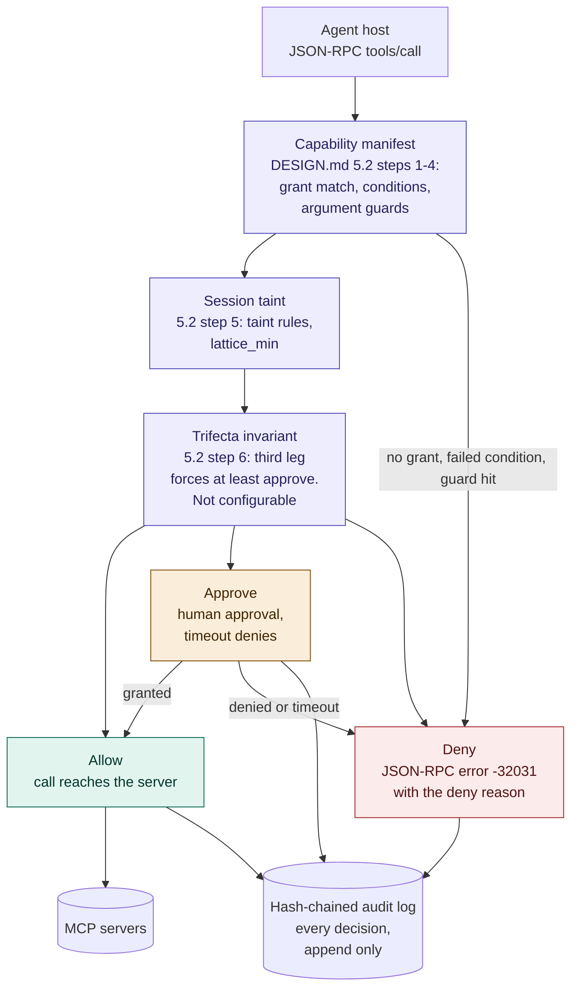

# bawbel-gate

Runtime enforcement for MCP agents. A deterministic proxy between the agent host and its
MCP servers that enforces capability manifests, session taint, and a non-configurable
rule-of-two trifecta invariant, with a hash-chained audit log.

The gate never reads model output. Every decision is made on structured JSON-RPC.

[](https://github.com/bawbel/gate/blob/main/LICENSE)
[](https://pypi.org/project/bawbel-gate/)
[](https://github.com/bawbel/gate/blob/main/pyproject.toml)
[-orange)](https://github.com/bawbel/gate#status-v010-feature-complete-pre-release)
[](https://github.com/bawbel/gate#install-development)
[](https://github.com/bawbel/gate/blob/main/DESIGN.md)
[](https://scorecard.dev/viewer/?uri=github.com/bawbel/gate)
[](https://github.com/bawbel/gate/actions/workflows/code-scan.yml)
[](https://github.com/bawbel/gate/actions/workflows/dependency-scan.yml)
[](https://github.com/bawbel/gate/actions/workflows/secret-scan.yml)
[](https://github.com/bawbel/gate/blob/main/SECURITY.md)
[](https://github.com/bawbel/gate/blob/main/CODE_OF_CONDUCT.md)
[](https://github.com/bawbel/gate/blob/main/CONTRIBUTING.md#pull-requests)

[Design](https://github.com/bawbel/gate/blob/main/DESIGN.md) · [Architecture](https://github.com/bawbel/gate/blob/main/ARCHITECTURE.md) · [Security](https://github.com/bawbel/gate/blob/main/SECURITY.md) · [Contributing](https://github.com/bawbel/gate/blob/main/CONTRIBUTING.md)

```bash
pip install bawbel-gate

bawbel-gate serve --config gate.yaml --learn         # observe, enforce nothing
bawbel-gate learn synthesize --out manifests/draft/  # draft manifests
bawbel-gate serve --config gate.yaml                 # enforce
```

`serve` is launched by your MCP client, not run by hand. Before the first `serve`, write
`gate.yaml` and one manifest per server. [Usage](https://github.com/bawbel/gate#usage) walks through each step and lists
what is not supported yet; [Commands](https://github.com/bawbel/gate#commands) lists every command and option.

## Status: v0.1.0 feature-complete (pre-release)

The enforcement core (policy engine, taint tracking, trifecta invariant, audit chain),
integrity pinning, learning mode, the embedded console, and the bawbel-hub server are
implemented. Gaps are listed under
[Not yet supported](https://github.com/bawbel/gate#not-yet-supported). The test suite
passes, including property, replay, and corpus tests. Releases are published to PyPI as
`bawbel-gate`. Pre-1.0: interfaces may change between minor versions.

## How it works



Every `tools/call` passes three checks, in order. The capability manifest check covers
DESIGN.md 5.2 steps 1 to 4: absence of a grant is a deny, and a failed condition or an
argument guard hit is a deny, never a fallthrough to the next grant. Taint rules and the
trifecta invariant can only move an effect down the lattice (`allow` to `approve` to
`deny`), never up, so the manifest's base grants are a static ceiling on what a session
can do. The trifecta step is not configurable: no manifest field, environment variable,
or flag disables it. Every decision is appended to the hash-chained audit log, and no
decision reads model output, only structured JSON-RPC.

## The problem

Agent hosts grant flat trust to everything in context. A tool response, a skill
file, and a user message carry equal instruction authority inside the model, because
the model processes one token sequence with no privilege boundary. That is not
fixable at the model layer. bawbel-gate fixes the consequence layer instead: a
deterministic proxy between the agent host and its MCP servers that enforces
per-component capability grants, session taint, and the trifecta invariant,
regardless of what the model decides to do.

## Usage

The gate is a stdio MCP server. Your MCP client launches `bawbel-gate serve`; the gate
spawns each upstream MCP server as a stdio subprocess and proxies between them. The
upstream servers' tools reach the client as `{server}__{tool}`.

### Install

From [PyPI](https://pypi.org/project/bawbel-gate/) (Python 3.10 or later):

```bash
pip install bawbel-gate
bawbel-gate --version
```

The `ops` extra adds the OpenTelemetry exporter. Without it, decision spans are no-ops.

```bash
pip install "bawbel-gate[ops]"
export OTEL_EXPORTER_OTLP_ENDPOINT=http://localhost:4317
```

Unreleased changes on the `develop` branch:

```bash
pip install "git+https://github.com/bawbel/gate.git@develop"
```

### Install (development)

```bash
git clone https://github.com/bawbel/gate.git
cd gate
git checkout develop
pip install -e ".[dev]" --break-system-packages
pytest                        # full suite
pre-commit run --all-files    # lint gate
```

### 1. Write gate.yaml

```yaml
schema: bawbel/gate-config/v1    # exact string, required
# absolute path; the directory must already exist
audit_log: /home/you/.bawbel/gate.audit.jsonl
approval:
  channel: terminal          # see "Approvals" in step 6
  timeout_seconds: 120       # 5 to 3600
  on_timeout: deny           # the only accepted value
servers:
  - name: github             # tools reach the client as github__<tool>
    command: github-mcp
    args: []
    manifest: manifests/github-mcp.cap.yaml
  - name: filesystem
    command: fs-mcp
    args: ["--root", "/work"]
    manifest: manifests/fs-mcp.cap.yaml
```

- `manifest` paths resolve relative to the directory that contains `gate.yaml`. Every
  server needs a manifest file, in learning mode too (step 3).
- `audit_log` resolves relative to the gate process's working directory, which the MCP
  client chooses. Use an absolute path. Default: `gate.audit.jsonl`.
- Server names must be unique. At least one server is required.
- Upstream servers inherit the gate's environment. Put their credentials there (the `env`
  block of the gate's client entry, step 2) and remove them from the upstream entries, so
  a direct connection to an upstream server fails auth.

### 2. Point your MCP client at the gate

Replace the upstream server entries in the client config with one entry for the gate:

```json
{
  "mcpServers": {
    "bawbel-gate": {
      "command": "bawbel-gate",
      "args": ["serve", "--config", "/home/you/.bawbel/gate.yaml"],
      "env": {"GITHUB_TOKEN": "<token>"}
    }
  }
}
```

Remove the direct entries for the upstream servers. A host that can reach a server
directly bypasses the gate (DESIGN.md 10, item 3).

### 3. Learn: record what the agent does

Learning mode forwards every call, enforces nothing, and still writes the audit chain.

It loads each server's manifest at startup. For a server that has no manifest yet, point
`gate.yaml` at a deny-all placeholder. Learning mode does not enforce it:

```yaml
schema: bawbel/capability-manifest/v1
subject: {kind: mcp-server, name: github-mcp}
provenance_class: tool.response.github
instruction_authority: none
trifecta: {private_data: true, untrusted_content: true, external_comms: true}
grants:
  tools:
    - name: "*"
      effect: deny
```

Observations are appended to `learn.observations.jsonl` in the gate process's working
directory when the session ends. `serve` has no option to move that file, so start the
gate from a known directory (`serve -c` is short for `serve --config`):

```json
{
  "mcpServers": {
    "bawbel-gate": {
      "command": "sh",
      "args": [
        "-c",
        "cd /home/you/.bawbel && exec bawbel-gate serve -c gate.yaml --learn"
      ]
    }
  }
}
```

The observations file holds the first 32 characters of every argument value in clear
text. Treat it as sensitive and delete it after synthesis.

### 4. Review and synthesize draft manifests

```bash
cd /home/you/.bawbel
bawbel-gate learn report                             # tools and argument shapes
bawbel-gate learn synthesize --out manifests/draft/  # a draft per server
```

`synthesize` overwrites an existing `<server>.cap.yaml` in the output directory. Write to a
separate directory, review each draft, then copy it to the path `gate.yaml` names.

What a draft contains, and what to review:

| Draft content | Review |
|---|---|
| `allow` for each observed tool, `approve` for tool names that look like writes | Remove grants the agent should not have |
| `conditions` narrowed to the common prefix of observed argument values | Check each pattern |
| Wildcard `"*": deny` as the last grant | Keep it |
| All three `trifecta` flags `true` | Set each flag to what the server actually does |
| Taint rule: once this server has responded, its tools need `approve` while `external_comms` is true | Keep or tighten; no rule can loosen step 6 |
| Argument guard: outbound secret scan, 64 KiB byte cap | Keep |
| `integrity_watch: tool_schema, on_drift: suspend` | Pin the schema in step 5 |

Minimal hand-written manifest (DESIGN.md 4.1 has the annotated version):

```yaml
schema: bawbel/capability-manifest/v1
subject:
  kind: mcp-server
  name: github-mcp
provenance_class: tool.response.github
instruction_authority: none
trifecta:
  private_data: true
  untrusted_content: true
  external_comms: true
grants:
  tools:
    - name: get_issue
      effect: allow
    - name: create_pull_request
      effect: allow
      conditions:
        args.base_repo: {pattern: "myorg/*"}
    - name: "*"
      effect: deny
```

### 5. Lint, pin, and harden

Lint is a static check. It runs in CI without starting any server:

```bash
bawbel-gate lint manifests/
bawbel-gate lint manifests/prod \
  --forbid-effect allow --tools-with external_comms
```

The second command fails if any manifest that declares `external_comms: true` contains an
`allow` grant, so no tool on an egress-capable server can run without an approval. `lint`
reads `*.yaml` files recursively; other extensions are skipped.

Pin each server's tool schema after reviewing its tool descriptions. `verify` takes the
`result.tools` array of the server's `tools/list` response:

```bash
{
  jq -nc '{jsonrpc: "2.0", id: 1, method: "initialize",
           params: {protocolVersion: "2025-06-18", capabilities: {},
                    clientInfo: {name: "pin", version: "0"}}}'
  jq -nc '{jsonrpc: "2.0", method: "notifications/initialized"}'
  jq -nc '{jsonrpc: "2.0", id: 2, method: "tools/list"}'
} | github-mcp \
  | jq -c 'select(.id == 2) | .result.tools' > github-tools.json

# compare with the stored pin
bawbel-gate verify github-tools.json manifests/github-mcp.cap.yaml
# write the pin
bawbel-gate verify github-tools.json manifests/github-mcp.cap.yaml --accept
```

`--accept` stores the hash in the manifest's `tool_schema_integrity` field and rewrites the
YAML file. Comments are not preserved. In enforcement mode, a pinned server whose live
`tools/list` hashes differently is suspended at session start: its tools are withheld and
calls to it are denied with `drift:suspended`.

Merge an AVE record's mitigation stanza into a manifest:

```bash
# print the diff only
bawbel-gate harden --ave AVE-2026-00041 \
  --manifest manifests/github-mcp.cap.yaml
# apply it
bawbel-gate harden --ave AVE-2026-00041 \
  --manifest manifests/github-mcp.cap.yaml --write
```

`harden` reads `mitigations/ave-mitigations.json` relative to the current directory. That
file ships in this repository, not in the installed package: run from a clone, or pass
`--mitigations PATH`. Stanzas whose `review_status` is not `reviewed` are refused unless
`--allow-unreviewed` is passed.

### 6. Enforce

Remove `--learn` from the client args. In each session:

1. Each pinned server's `tools/list` is hashed and compared to its pin. Drift suspends the
   server.
2. `tools/list` returns `{server}__{tool}` names, without tools whose grant resolves to
   `deny`.
3. Each `tools/call` runs the pipeline in [How it works](https://github.com/bawbel/gate#how-it-works). An allowed call is
   forwarded. A denied call is not forwarded and returns:

   ```json
   {
     "jsonrpc": "2.0",
     "id": 7,
     "error": {
       "code": -32031,
       "message": "bawbel-gate: denied",
       "data": {"reason": "condition_failed", "ave": []}
     }
   }
   ```

   `data.reason` is one of the [deny reasons](https://github.com/bawbel/gate#deny-reasons), except that a deny produced
   by a `deny` grant or a taint rule currently carries `resolved`. `data.ave` is always
   empty in the current code.
4. Every decision is appended to `audit_log`. The chain head is printed on stderr when the
   session ends.

#### Approvals

The terminal channel writes the approval prompt (tool, secret-redacted arguments, reason,
taint classes, timeout) to stderr and reads the answer from stdin. When an MCP client
launches the gate, stdin is the client's JSON-RPC stream, so the client's next message is
read as the answer. The call is denied and audited as `approval_denied`, and the consumed
client message gets no response. In a client-launched deployment, plan for every `approve`
effect to resolve to `deny`. The `webhook` and `slack` channels pass config validation but
are not implemented, and the console approval endpoint is not connected to the proxy.

### 7. Audit and operate

```bash
bawbel-gate audit verify /home/you/.bawbel/gate.audit.jsonl
bawbel-gate audit tail /home/you/.bawbel/gate.audit.jsonl -n 50 --follow
bawbel-gate posture --audit-log /home/you/.bawbel/gate.audit.jsonl
```

`audit verify` exits 0 with `ok: N records, chain intact`, or exits 1 with the first broken
link on stderr. `posture` and `clear` default to `bawbel-audit.jsonl`, not to the gate's
`audit_log`; pass `--audit-log`.

`bawbel-gate clear --session ID --confirm --audit-log FILE` appends a `SESSION_CLEAR`
record. It does not signal a running gate. Taint lives in the gate process and ends with
the session, which ends when the client disconnects.

`serve --console 127.0.0.1:7317` starts the read-only console on loopback (see
[Embedded console](https://github.com/bawbel/gate#embedded-console-m6)).

### Not yet supported

- Upstream servers that validate the MCP handshake. The gate sends `initialize` with empty
  `params` and no `notifications/initialized`. Servers built on the official MCP Python
  SDK reject that handshake, and the gate then exposes none of their tools ([#27](https://github.com/bawbel/gate/issues/27)).
- MCP methods other than `initialize`, `tools/list`, and `tools/call`. They return
  `-32601`, and the gate advertises only the `tools` capability, so resources and prompts
  are not reachable through the gate (DESIGN.md 3.3).
- Transports other than stdio, on either side of the gate.
- Clean stdout. The mode banner and the console URL with its token are written to stdout,
  the JSON-RPC channel, and clients log them as parse errors ([#28](https://github.com/bawbel/gate/issues/28)).
- Error responses for malformed JSON-RPC from the client. A line that is not JSON is
  dropped with a stderr warning: no response, no audit record.
- Fleet ingest from gates to bawbel-hub. Gates do not send records yet, and the hub has
  no per-gate identity or TLS. See [bawbel-hub (M7)](https://github.com/bawbel/gate#bawbel-hub-m7).

## Commands

Every command takes `--help`. `bawbel-gate --version` prints the installed version.

| Command | What it does | Arguments and options | Notes |
|---|---|---|---|
| `serve` | Runs the proxy on stdio. Launched by the MCP client | `--config`, `-c PATH` (required); `--learn`; `--console HOST:PORT` (env `BAWBEL_CONSOLE_ADDR`) | Enforces unless `--learn`. `--console HOST` without a port uses 7317. Exits when the client closes stdin |
| `learn report` | Prints tools called per server, call counts, argument types, and argument prefixes | `--obs PATH` (default `learn.observations.jsonl`) | Reads the file learning mode wrote |
| `learn synthesize` | Writes one draft manifest per observed server | `--out DIR` (required); `--obs PATH` (default `learn.observations.jsonl`) | Overwrites `<server>.cap.yaml` in `DIR`. Output is a draft, not policy |
| `lint MANIFEST_DIR` | Validates every `*.yaml` under `MANIFEST_DIR` against the capability manifest schema | `--forbid-effect EFFECT`; `--tools-with FLAG`; `--schema` (accepted, no effect) | `--forbid-effect` fails on any `EFFECT` grant; `--tools-with` limits that to manifests whose `trifecta.FLAG` is true. Exit 1 on any failure |
| `verify TOOLS_JSON MANIFEST` | Compares a `tools/list` result against the manifest's `tool_schema_integrity` pin | `--accept` | No pin: prints the hash, exit 0. Drift: exit 1 unless `--accept`. `--accept` rewrites the manifest without comments |
| `harden` | Merges an AVE record's `capability_mitigation` stanza into a manifest | `--ave AVE_ID` (required); `--manifest FILE`; `--write`; `--allow-unreviewed`; `--mitigations PATH` (default `mitigations/ave-mitigations.json`) | Prints the diff. Writes only with `--write`. Refuses unreviewed stanzas by default |
| `audit verify FILE` | Replays the hash chain | none | Exit 0: `ok: N records, chain intact`. Exit 1: first broken link on stderr |
| `audit tail FILE` | Prints the last audit records as JSONL | `-n`, `--lines N` (default 20); `-f`, `--follow` | |
| `posture` | Prints an agent risk posture report from an audit log | `--audit-log PATH` (default `bawbel-audit.jsonl`, env `BAWBEL_AUDIT_LOG`); `--json` | |
| `clear` | Appends a `SESSION_CLEAR` audit record for a session | `--session ID` (required); `--confirm` (required); `--audit-log PATH` (default `bawbel-audit.jsonl`) | Does not reach a running gate |
| `enroll` | Enrolls this gate with a bawbel-hub | `--hub URL` (required); `--token TOKEN` (required) | Prints the assigned `gate_id` |
| `hub serve` | Runs the bawbel-hub ingest service and fleet console | `--db PATH` (default `bawbel-hub.db`, env `BAWBEL_HUB_DB`); `--host` (default `127.0.0.1`, env `BAWBEL_HUB_HOST`); `--port` (default 8443, env `BAWBEL_HUB_PORT`) | Prints the admin token at startup |
| `hub token new` | Mints a single-use enrollment token | `--db PATH` (default `bawbel-hub.db`, env `BAWBEL_HUB_DB`) | Pass the token to `enroll --token` |

## What is built

| Milestone | Component | Status |
|---|---|---|
| M0 | Project scaffold, schemas, migration script | done |
| M1 | MCP multiplexer, learning mode, audit skeleton | done |
| M2 | Policy engine, taint tracker, trifecta invariant, audit chain | done |
| M3 | Integrity pinning, drift detection, `harden --ave` | done |
| M4 | Approval UX budget, benign corpus, latency gates | done |
| M5 | OTel spans, CEF/syslog export, posture report | partial: no CEF/syslog exporter |
| M6 | Embedded console + Console API | done |
| M7 | bawbel-hub: fleet ingest, state store, enrollment | partial: gate-side push not wired |

### Policy engine (M2)

Six-step decision pipeline per DESIGN.md 5.2:

1. Match grant by tool name (exact then wildcard).
2. No match -> `deny: no_grant`. Fail closed.
3. Conditions fail -> `deny: condition_failed`. No fallthrough to next grant.
4. Argument guards: secret scan and byte cap.
5. Taint rules: `lattice_min` only, effects never rise.
6. Trifecta invariant: `private_touched AND untrusted_seen AND external_comms` ->
   at least `approve`. Cannot be disabled by any manifest field or flag.

Effect lattice: `allow (2) > approve (1) > deny (0)`. Deny absorbs everything.

### Trifecta invariant

The rule-of-two protection against prompt injection exfiltration. When a session
has touched private data, seen untrusted content (a tool response, a web fetch, an
issue body), and calls a tool with external comms capability, a human must approve.
This is not configurable. No manifest field, environment variable, or debug flag
can bypass it.

### Integrity pinning (M3)

Tool schemas are hashed at review time (`bawbel-gate verify`). On each session
start the gate re-hashes and compares. Any mutation -- a poisoned description, an
injected tool, a rug-pull -- is detected as drift. The server is suspended and all its
tools withheld until the operator reviews the changed tool definitions and runs
`bawbel-gate verify --accept`, which stores the new hash. `verify` reports the stored
and current hashes; it does not produce a diff.

### Audit log (M2)

Append-only JSONL. Every record carries `hash = sha256(canonical(record) || prev)`.
The chain is verified on demand (`bawbel-gate audit verify`). Argument payloads are
hashed, never stored (`args_sha256`). The forensic record is local and
tamper-evident; OTel decision spans (`ops` extra) are an operational feed on top of it.

### Embedded console (M6)

`bawbel-gate serve --console 127.0.0.1:7317` starts a loopback HTTP server. A
random bearer token is printed once at startup. Endpoints:

| Endpoint | Method | Description |
|---|---|---|
| `/v1/state` | GET | Full snapshot: sessions, servers, pending approvals, audit head |
| `/v1/events` | GET | SSE stream of audit records as they are written |
| `/v1/approvals/{id}` | POST | Console approval channel (race-safe: first writer wins). Not yet connected to the proxy; see [Approvals](https://github.com/bawbel/gate#approvals) |
| `/` | GET | Embedded UI bundle |

The console is read-only except for the approval endpoint. No endpoint can issue
tool calls, edit manifests, or clear taint; those remain CLI-only.

`/v1/state` reflects live session taint and per-server manifest state as the gate
runs:


### bawbel-hub (M7)

Self-hosted fleet manager for teams running more than one gate. Push-only by design:
the hub never connects to a gate. The hub side below is implemented. The gate-side push
client (`ingest/client.py`) is not wired into `serve`, so gates do not send records yet.

Also not implemented: per-gate identity and TLS. Ingest authenticates with the hub's
shared admin token (the one `hub serve` prints at startup), `gate_id` is taken from the
request path, and `hub serve` listens on plain HTTP. DESIGN.md 14.3 specifies a per-gate
mTLS client certificate. Enrollment tokens are single-use but do not expire.

- Ingest service (`POST /v1/gates/{gate_id}/records`): verifies the hash chain per
  session and stores records idempotently by `(gate_id, session_id, seq)`. A batch
  with a broken chain is rejected with HTTP 409 `chain_mismatch`; nothing from it is
  stored.
- Fleet state store: SQLite, fully rebuildable from raw records.
- Single-use enrollment tokens: `bawbel-gate hub token new`, then
  `bawbel-gate enroll --hub URL --token TOKEN`.
- Fleet posture API: `GET /v1/fleet/state` returns per-gate allow/approve/deny
  counts, trifecta trips, and drift events.

## Deny reasons

The reasons the code sets in `data.reason` on a deny. Each deny carries exactly one:

| Reason | Cause |
|---|---|
| `no_grant` | No grant matched the tool name, or the name is not `{server}__{tool}` |
| `resolved` | The matched grant's effect is `deny` (including the `"*"` wildcard), or a taint rule lowered the effect to `deny` |
| `condition_failed` | A matched grant's condition was not satisfied |
| `guard:secret_scan` | An argument contained a secret pattern |
| `guard:byte_cap` | An argument exceeded the outbound byte cap |
| `approval_denied` | The approval was denied. Under an MCP client, the terminal channel also produces this when it consumes a client message (see [Approvals](https://github.com/bawbel/gate#approvals)) |
| `approval_timeout` | No approval answer within `approval.timeout_seconds` |
| `drift:suspended` | The server is suspended after tool-schema drift, or the `{server}` prefix names no configured server |

`trifecta_third_leg` is the reason on an `approve` decision, not on a deny. If that
approval is denied or times out, the deny carries `approval_denied` or
`approval_timeout`. A request line that is not valid JSON is dropped with a stderr
warning naming `parse_error`; no deny is sent.

## Alertable events

DESIGN.md 8.5 defines six event classes. The gate sends an event as an OTel span only
when an OTel tracer is configured (`ops` extra); otherwise sending is a no-op. The audit
log records the underlying decisions either way.

| Event | Default severity | Meaning | Emitted today |
|---|---|---|---|
| `gate.drift.detected` | high | Supply-chain mutation post-review | yes, at session start |
| `gate.trifecta.trip` | medium | Injection precondition reached | no |
| `gate.deny.burst` | medium | Agent probing outside granted surface | no |
| `gate.secretscan.hit` | high | Exfiltration attempt via arguments | no |
| `gate.approval.timeout` | low | Unattended agent hit a human gate | no |
| `gate.chain.gap` | critical | Audit log tamper indicator | no; the hub returns HTTP 409 |

## Non-goals

- Not a prompt filter. Every enforcement decision reads structured JSON-RPC only;
  the gate never consults what the model said.
- No fail-open mode, no configurable trifecta bypass, no "trust this server fully"
  toggle.
- No inbound connections to gates, ever, in any deployment shape.
- No argument payloads in the audit log. Records carry `args_sha256`. Learning-mode
  observations are a separate file (Usage, step 3).

## Documentation

- [DESIGN.md](https://github.com/bawbel/gate/blob/main/DESIGN.md) - normative specification.
- [ARCHITECTURE.md](https://github.com/bawbel/gate/blob/main/ARCHITECTURE.md) - ecosystem map.
- [docs/LANGUAGE.md](https://github.com/bawbel/gate/blob/main/docs/LANGUAGE.md) - canonical terminology.
- [CHANGELOG.md](https://github.com/bawbel/gate/blob/main/CHANGELOG.md) - notable changes since the M0-M7 baseline.

## Related projects

- [AVE](https://aveproject.org) - the behavioral vulnerability classification
  standard bawbel-gate enforces against (`bawbel-gate harden --ave`), an independent
  project ([aveproject/ave](https://github.com/aveproject/ave)).
- [bawbel-scanner](https://pypi.org/project/bawbel-scanner/) - static detection
  for agent codebases, MCP configs, and server cards.
- PiranhaDB - the queryable AVE corpus API. No public endpoint yet.

## Security

See [SECURITY.md](https://github.com/bawbel/gate/blob/main/SECURITY.md) for the disclosure policy. Do not open a public
issue for a vulnerability.

## License

Apache-2.0. The gate is fully standalone and open. bawbel-hub (fleet management for
more than one gate) is the paid tier; see DESIGN.md 14 for the boundary.

## Contributing

See [CONTRIBUTING.md](https://github.com/bawbel/gate/blob/main/CONTRIBUTING.md). Read DESIGN.md before opening a PR that
touches `policy/`, `taint/`, `audit/`, or `integrity/`: behavior that diverges from
the spec needs a DESIGN.md change first, not a larger diff. Commits must carry a
DCO sign-off (`git commit -s`); see [GOVERNANCE.md](https://github.com/bawbel/gate/blob/main/GOVERNANCE.md) for who
decides what, and [CODE_OF_CONDUCT.md](https://github.com/bawbel/gate/blob/main/CODE_OF_CONDUCT.md) for how we treat
each other while doing it.
